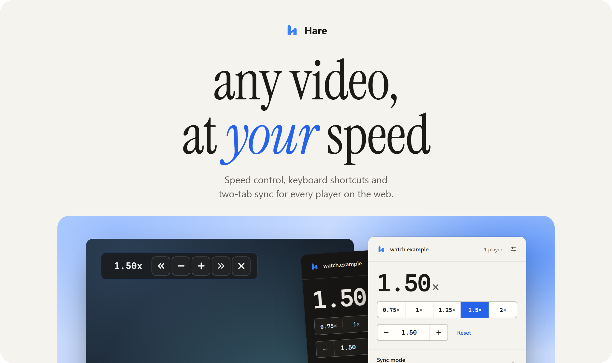
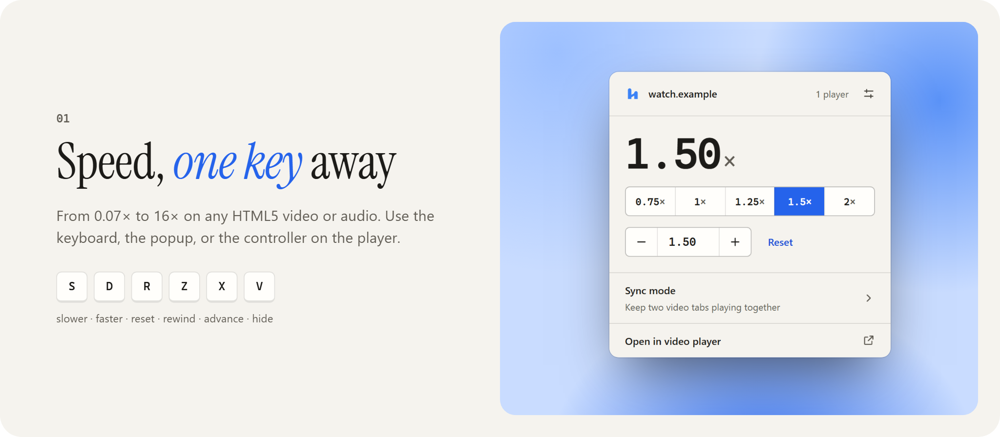
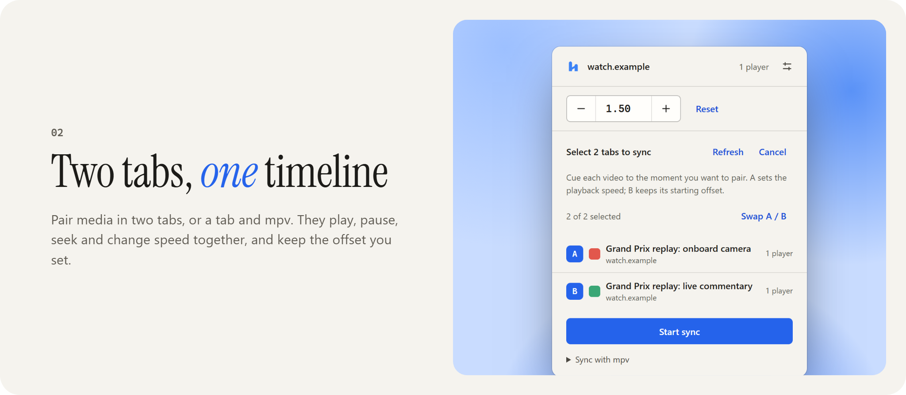
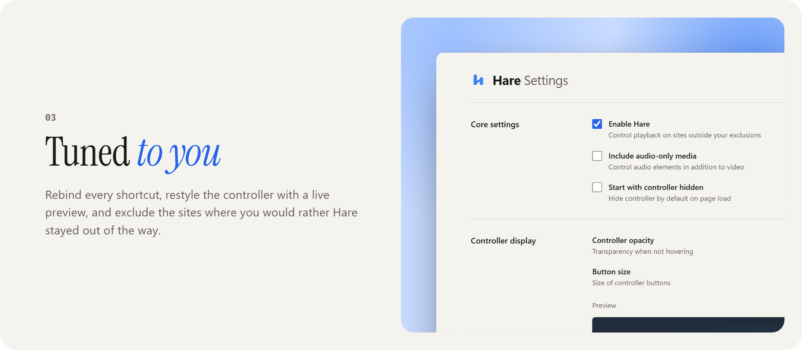

<picture>
  <source media="(prefers-color-scheme: dark)" srcset=".github/readme/hero-dark.png">
  
</picture>

<p align="center">
  <a href="https://addons.mozilla.org/firefox/addon/hare-video-controller/"><b>Get Hare for Firefox</b></a>
  &nbsp;·&nbsp;
  <a href="https://chromewebstore.google.com/detail/hare/ammjljaajbbpfeiiecicidpjnlagamkn"><b>Get Hare for Chrome and Edge</b></a>
  &nbsp;·&nbsp;
  <a href="https://anthonyy232.github.io/Hare/"><b>Website</b></a>
</p>

Hare is a browser extension that sets the playback speed of any HTML5 video or audio, from 0.07× to 16×. It works from the keyboard, from a small controller on the player, or from the toolbar popup, and it can keep two tabs playing in step.

<picture>
  <source media="(prefers-color-scheme: dark)" srcset=".github/readme/feature-speed-dark.png">
  
</picture>

| Key | Action |
| :-: | --- |
| `S` | Slower by 0.1× |
| `D` | Faster by 0.1× |
| `R` | Reset to 1× |
| `Z` | Rewind 10 seconds |
| `X` | Advance 10 seconds |
| `V` | Show or hide the controller |

Every key and amount can be changed. Shortcuts are single keys without modifiers, and they do nothing while you type in a text field.

The popup has presets for 0.75×, 1×, 1.25×, 1.5× and 2×, and a box for any other speed. It applies to all media in the current tab. Some players reject certain speeds or allow a narrower range.

The on-page controller shows the current speed, can be dragged anywhere on the player, and fades until you hover it. Hare has tuned handling for YouTube, Netflix, Prime Video, Disney+, Twitch and 10 more sites.

<picture>
  <source media="(prefers-color-scheme: dark)" srcset=".github/readme/feature-sync-dark.png">
  
</picture>

Sync mode pairs media in two tabs so they play, pause, seek and change speed together. It suits a second camera angle, a commentary track, or a reaction video next to its source.

1. Load media in two tabs and cue each to the moment you want to pair.
2. Open **Sync mode** and select tab A, then tab B. **Swap A / B** changes their roles.
3. Press **Start sync**.

A sets the playback speed and play or pause state. B keeps its starting offset, which you can fine-tune with the offset buttons. Closing a paired tab, replacing its media, or turning Hare off ends the session. Each tab syncs one video, preferring playing media and then the larger player.

**Sync with mpv.** Open **Sync with mpv** in the Sync mode list, download [hare.lua](public/hare.lua), and move it to mpv's scripts folder (`%APPDATA%\mpv\scripts` on Windows, `~/.config/mpv/scripts` on macOS and Linux). After that, any video you open in [mpv](https://mpv.io) appears in the list. The script needs an mpv build that uses LuaJIT, which most do. Only one mpv window can be paired at a time, and opening another file in mpv ends the session. The script listens on `127.0.0.1:42730` and only answers requests from browser extensions.

<picture>
  <source media="(prefers-color-scheme: dark)" srcset=".github/readme/feature-settings-dark.png">
  
</picture>

- **Core settings**: turn Hare on or off, include audio-only media, or start with the controller hidden.
- **Controller display**: opacity and button size, with a live preview.
- **Keybindings**: each shortcut's key and amount. **Override site shortcut** wins when a site uses the same key.
- **Excluded sites**: domains, URLs, or `/regular expressions/`, also applied to players embedded in those pages. Defaults: Instagram, X/Twitter, Imgur, Teams and Google Meet.

Click **Save settings** to apply changes to open pages. Settings follow you across devices through your browser's sync, and the popup and settings page follow your browser's light or dark theme.

On an excluded site, **Use Hare on this site** in the popup removes that site's exclusion. Broader domain or regular expression rules stay and can be edited in Settings.

## Open in your video player

**Open in video player** at the bottom of the popup saves `hare.m3u` to your Downloads folder and opens it with your default player for `.m3u` files. It points to the video file, or to the HLS/DASH stream the page plays, such as on Twitch, Kick, Patreon and PeerTube. For protected or site-specific formats, such as YouTube and Vimeo, it points to the page itself, which players that resolve sites (such as mpv with yt-dlp) can play. The playlist also tells the player where to start and which site the video is from, which some hosts, such as Patreon's, require. VLC reads these on its own; mpv needs [hare.lua](public/hare.lua).

Video calls and screen shares can't be opened. The first use asks for permission to manage downloads. Firefox doesn't let Hare open the file itself, so click `hare.m3u` in the downloads panel.

## Install

**Firefox:** install from [Firefox Add-ons](https://addons.mozilla.org/firefox/addon/hare-video-controller/).

**Chrome and Edge:** install from the [Chrome Web Store](https://chromewebstore.google.com/detail/hare/ammjljaajbbpfeiiecicidpjnlagamkn). Edge asks you to allow extensions from other stores first.

Reload pages that were already open. Browser settings pages and some protected pages can't run extensions. For local files, allow file access in the extension's details.

Hare supports Firefox, Chrome and other Chromium browsers such as Edge (Edge isn't tested separately). Safari isn't supported.

## Building from source

For Firefox add-on review. Release packages are built on Ubuntu with Node.js 24 and npm 11, as in Mozilla's default reviewer environment ([install Node.js](https://nodejs.org/en/download) if needed). In the extracted source archive, run:

```bash
npm ci
npm run build:firefox
```

The extension is built to `.output/firefox-mv3/` and matches the submitted package. `npm ci` installs the exact versions in `package-lock.json` from the public npm registry; no credentials are needed.

## Contributing

Contributions are welcome. Read [AGENTS.md](AGENTS.md) before opening a pull request.

## License

Copyright (c) 2026 Anthony La.

Hare is free software, licensed under the [GNU General Public License v3.0](LICENSE) only, and comes with no warranty. Versions up to 1.10.0 were released under the MIT License.

Inspired by [videospeed](https://github.com/igrigorik/videospeed) by Ilya Grigorik.
